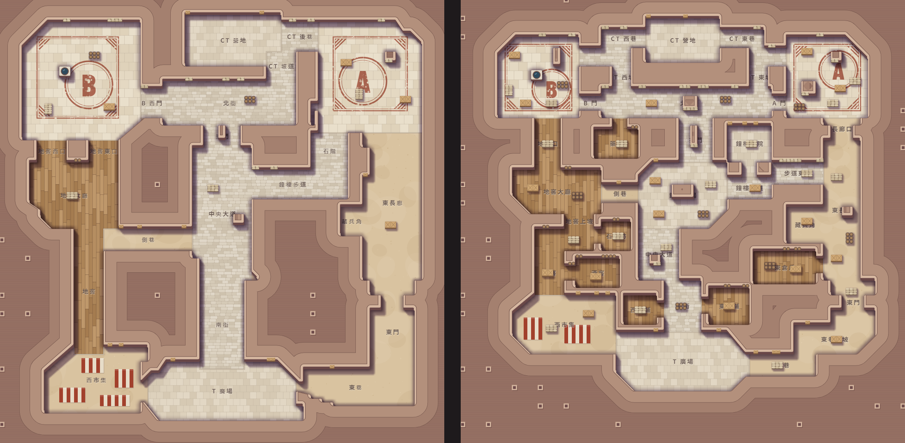
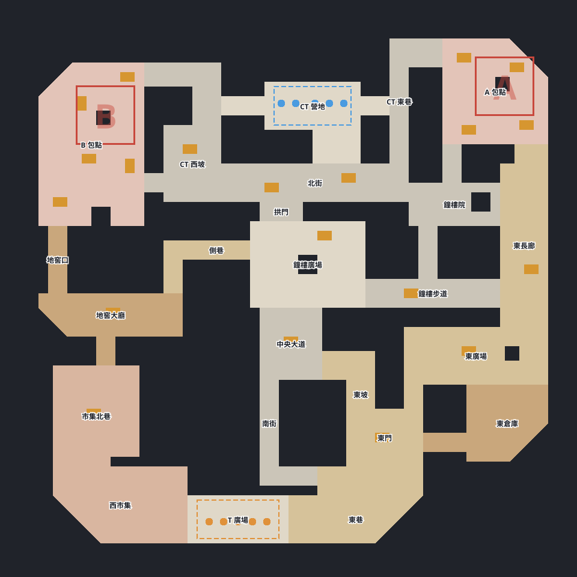

# 攻防戰 新地圖方案（赤岩舊城）

2026-10-31 · 狀態：第一版草案已否決，定案版見下一節（2026-11-01 更新）

> 更新：這份文件描述的第一版草案有七間單門死路房與過多掩體，已被使用者否決。接下來由使用者用地圖編輯器（`web/shooter-map-editor.html`）親手改圖，起點是 `maps/shooter/redrock2.json`（死路全接通、矮掩體 21 組的試算版）。下面的數字都是第一版的。

- 看大圖：[map-draft.png](../web/sketch/shooter/shots/map-draft.png)，或開 `web/sketch/shooter/a-diorama.html?view=map&draft`。
- 草案資料：[map-draft.ts](../src/web/sketch/shooter/map-draft.ts)，格式與引擎的 `MapLayout` 相同，定案後可以整段搬過去。
- 全圖上的區域字被箱子蓋到的地方是預覽還沒調，不是地圖問題。

## 定案版（2026-11-01）

下面第一～六節是被否決的第一版草案。現行地圖是使用者用編輯器畫的版本：

- `maps/shooter/redrock2-v3.json`：使用者採用的第三版。
- `maps/shooter/redrock2-v4.json`：幾何與第三版相同，41 個框併成 24 個正式區域、加材質。
- 兩張都能在試玩頁選，預設地圖不換，閘道缺 `mapId` 時走赤岩鎮。
- 骨架沒變：北 CT、南 T、A 東、B 西，三條主路、兩條橫向連接，每個包點三個入口，沒有死路。
- 大樣本、改圖建議與區域清單在[交付報告](2026-11-01_CS射擊_新地圖製作_交付報告.md)。
- 待決定：正式代號、是否換預設、是否加寬 A 南門與 B 門。

## 一、改了什麼

骨架沒變：北 CT、南 T、A 東、B 西，西地窖、中央大道、東長廊三條路，側巷與鐘樓步道兩條橫向連接，每個包點三個入口。

| 地方 | 赤岩鎮 | 草案 |
| --- | --- | --- |
| 包點 | 大方房間，幾乎只有四周牆可靠 | 縮到 22×22，房內 7 個獨立掩體（井、斷牆、石柱、大箱＋矮掩體） |
| 地窖路線 | 34 格直管，出口是兩扇緊鄰的門 | 地窖、轉角、上坡、大廳、地窖口，中段橫移一次；旁邊有酒窖、石匠坊 |
| 中路 | 南街到拱門一條線看穿 | 南街、中央大道、拱門三段錯開；中間是鐘樓廣場，鐘樓基座擋視線 |
| 東路 | 東巷、東門、16 格寬的長廊直接開進 A | 長廊收窄到 10 格，進 A 前有 6 格寬的長廊口；保留一條 57 格的狙擊線 |
| 北街 | B、A 之間暢通 | 中段加鐘樓牆，B 門與 A 門對不到線；CT 有東西兩條坡道下北街 |
| CT 出口 | 只有東側，到 A 近、到 B 遠 | 東西兩條後巷各轉一次，到兩包點距離拉平 |
| T 廣場 | 東西貫穿全圖 | 西市集與東巷的門上下錯開 |
| 側室 | 幾乎沒有 | 新增酒窖、石匠坊、西／東商鋪、藥鋪、東倉房、鐘樓內院，讓鎮有內部，也把牆的量體切小 |

## 二、實測對照

兩張圖用同一支量測腳本。秒數以 AK／M4 的移動速度（約 4.1 格／秒）計算。

| 指標 | 赤岩鎮 | 草案 |
| --- | --- | --- |
| 包點房間 | A 28×30、B 32×32 | 都是 22×22 |
| 可下包區 | A 20×20、B 22×22 | 都是 18×18 |
| 包點房內獨立掩體 | 4、4 | 7、7 |
| 矮掩體 | 10 組（60 格） | 42 組（252 格） |
| 離掩蔽超過 4 格的可走格 | 20% | 5% |
| CT 到 A／B | 6.6 秒／14.3 秒 | 7.6 秒／7.9 秒 |
| T 到 A／B | 23.3 秒／23.5 秒 | 22.7 秒／21.3 秒 |
| 最長東西直走 | 100 格 | 58 格 |
| 最長南北直走 | 106 格 | 57 格（刻意留的東長廊狙擊線） |
| 一格寬窄縫 | 5 格 | 無 |
| 一格厚細牆 | 8 格 | 無 |
| 可走面積 | 49.2% | 40.0% |

T 的路程只短了 1～2 秒，地圖尺寸沒變，能改善的主要是路上有轉折與選擇，不是距離。

**現行地圖測試的條件**，草案用同算法都通過：可走格全部連通、出生區之間沒有直線視線、每個包點至少 3 個入口、包點有矮牆、出生點與區域查詢正確。可走面積 40.04%，剛好壓在規格下限（40%～55%）上，幾乎沒有餘裕；之後再加掩體就要同步補走道面積，或放寬下限。

## 三、Bot 試跑

用暫存腳本把草案掛進地圖表（沒改檔），基準 Bot 2.1 對基準 Bot 2.1，兩張圖各 10 個種子。評測會交換座位，但雙方是同一隻 Bot，等於各 10 場獨立比賽。

| 指標 | 赤岩鎮 | 草案 |
| --- | --- | --- |
| 例外／超時 | 0／0 | 0／0 |
| T 回合勝率 | 48.9%（221 回合） | 54.5%（253 回合） |
| 下包率 | 71.5% | 77.5% |
| 首次接觸 | 17.8 秒 | 20.4 秒 |
| 換血率 | 18.3% | 23.5% |
| 回防成功率 | 35.4% | 31.1% |
| 打進加時 | 1／10 場 | 3／10 場 |

Bot 不用改就能打完整場，路線與站位都是從地圖資料算的。T 勝率偏高可能是地圖真的比較利攻方，也可能是樣本太小，10 場分不出來；定案前要跑大樣本。Bot 沒有針對新圖調過，陪練 Bot（`shooter-practice.js`）也還沒測。

## 四、影響範圍

| 項目 | 要做的事 |
| --- | --- |
| `src/shooter/map.ts` | 新增 `REDROCK2_LAYOUT`、`MAPS.redrock2`；舊圖不動 |
| `src/shooter/gateway.ts` | `GATEWAY_MAP_ID` 目前寫死，閘道不看請求單。要在請求單加地圖欄位，缺值當 `redrock`，舊存檔重播才會走舊圖 |
| `test/shooter-map.test.ts` | 通用檢查會自動涵蓋新圖；「預設是赤岩鎮」那段要改 |
| `src/shooter/ai-scenarios.ts`、`scripts/shooter-*.ts` | 驗收情境與強度腳本的地圖清單寫死，要決定各跑哪幾張 |
| 規格文件 | 第四節、修訂紀錄；地圖屬凍結內容，照第九節升 `SHOOTER_ENGINE_VERSION` 並重跑全部驗收與強度表。`MapInfo` 欄位不變，API 版本不用升 |
| 區域名 | 草案有 46 個區域，門洞也算一區，正式版要併掉或不顯示，否則畫面與 Bot 喊話會太碎 |
| 美術 A | 牆、影子、迷霧自動跟著新圖；材質分區已接上，道具要針對新圖重擺 |

## 五、步驟

1. 新圖進引擎（只新增、不換預設），補請求單地圖欄位與測試。舊存檔與舊回放不受影響。
2. 可玩版開地圖選項，讓使用者先實際走過、打過，依手感調整。
3. 大樣本跑 Bot，看 T／CT 平衡與 A／B 分布，必要時調掩體與門寬。
4. 確認後才換預設地圖，同步更新閘道、規格、強度表。
5. 依新圖做方向 A 的正式美術。

第 1、2 步之間，A 的美術可以先做共用部分（牆、地面、迷霧、模型兵、HUD），因為這些都不綁特定地圖。

## 六、待決定

- 地圖名稱：草案暫名「赤岩舊城」，代號 `redrock2`。
- 預設切換時機：建議試玩並跑完大樣本才換，不要一合併就換。
