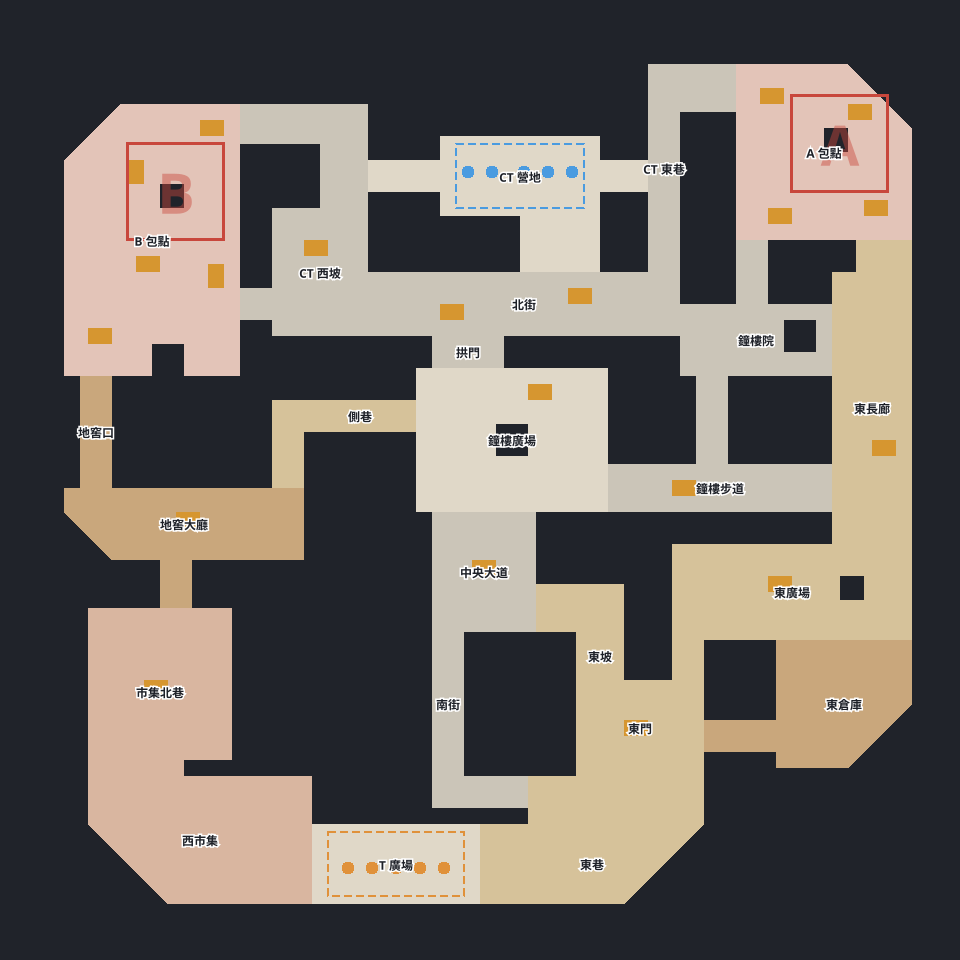

# CS 射擊 新地圖製作 交付報告：赤岩舊城

- 日期：2026-11-01
- 分支：`claude/cs-map-redrock2-0359e8`，未 push；已併入使用者的 `claude/cs-art-sketch-661c2e`（dbf4b8c）
- 結論：赤岩舊城能在試玩頁選到、Bot 能整場打完。檢查器沒有硬錯；Bot 回防明顯比赤岩鎮弱，最有效的修法是加寬兩扇門，等你在編輯器決定。

## 一、現況與分工變更

起點是使用者親手改的 `maps/shooter/redrock2-v3.json`（41 個區域框）。工作途中收到分工變更：使用者已在 dbf4b8c 把第三版登錄進引擎並讓試玩頁可選圖，地圖登錄與試玩選圖改以它為準。

| 項目 | 合併結果 |
| --- | --- |
| 地圖登錄 | 用 dbf4b8c 的做法：地圖代號等於檔名，`MAPS` 直接載入 JSON。本分支的 `redrock2` 代號與 `REDROCK2_LAYOUT` 包裝已取消 |
| 試玩下拉 | 用 dbf4b8c 的版面（與種子同一列），多一個第四版選項 |
| `main.ts`、`protocol.ts`、`worker.ts` | 兩邊內容幾乎相同，取 dbf4b8c |
| 因此省掉的工作 | 地圖登錄與試玩選圖不必再維護兩份。這兩項在收到通知前已做完，實際省掉的是後續維護，不是工時 |
| 仍由本分支提供 | `MatchRequest.mapId`、`material`、`callout`、編輯器支援、腳本參數、大樣本 |

## 二、驗收表

| 項目 | 結果 | 數據 |
| --- | --- | --- |
| JSON 地圖進引擎 | 過，代號與任務書不同 | `MAPS` 多 `redrock2-v3`、`redrock2-v4`；`REDROCK_LAYOUT`、`DUST_LAYOUT`、`DEFAULT_MAP_ID` 不動。測試：兩次 `buildMap` 的 `solid` 相同，第三、四版格子相同 |
| 請求單帶地圖 | 過 | 選用 `mapId`，缺值當 `redrock`。測試：缺值與明寫 `redrock` 的成績單、雜湊相同；新圖的閘道、觀戰、回放重播雜湊相同；未知地圖拒絕。`src/manage/gateway.ts` 只多一個場地代號，註解無賽制字樣 |
| 試玩選圖 | 過 | 下拉有赤岩鎮、第三版、第四版；`#watch` 用帶 `mapId` 的票實測，開的是請求單指定的圖；CLI `shooter match --map` 本來就吃 `MAPS` |
| 瀏覽器走一圈 | 部分過 | 見第五節；人類操作的拆包沒走到 |
| 編輯器檢查 | 硬條件全過，超長線有提醒 | 見第三節 |
| Bot 大樣本 | 過 | 第四版 200 場；例外 0、決策逾時 5 次（約 4 千萬次決策中的 5 次，見第四節） |
| 陪練 Bot | 過 | 陪練鏡像 40 場、基準對陪練 30 場，例外 0、逾時 0，沒有卡住 |
| 區域名 | 過 | 41 個框併成 24 個正式區域 |
| 材質欄位 | 過 | `areas[].material`，`MapInfo` 不動、API 不升；編輯器瀏覽器實測能看能改 |
| 文件 | 過 | 規格書第四、十節與補記、方案文件定案版、README |
| 工程 | 過 | typecheck 0、eslint 0、vitest 466 過 1 敗（既有 S16 軍團戰情境）、`build:web` 過；`bots/` 無差異，`--check` 一致 |

## 三、編輯器檢查表（第四版）

| 檢查 | 結果 |
| --- | --- |
| 出生點 | 數量、位置、間距都合格 |
| 連通 | 所有可走格都連通 |
| 出生區視線 | 沒有直線視線 |
| A、B 包點 | 各 3 個入口，可下包 12×12 |
| 區域代號 | `tSpawn`、`aSite` 位置正確，無重複 |
| 區域併入 | 都指到排在前面的主區域 |
| 正式區域 | 24 個，併入的框 17 個 |
| 可走面積 | 44.2%（規格 40%～55%） |
| 斜切邊、鋸齒斜角 | 都是 45°，無鋸齒 |
| 死路 | 無 |
| 一格寬窄縫、一格厚細牆 | 無 |
| 沒有區域名的可走格 | 無 |
| **最長直線** | **提醒：東西 75 格、南北 74 格** |

| 路程 | 赤岩鎮 | 赤岩舊城 |
| --- | --- | --- |
| T 到 A／B 中心 | 26.5／27.0 秒 | 31.2／27.7 秒 |
| CT 到 A／B 中心 | 10.0／17.1 秒 | 12.1／11.3 秒 |
| A 到 B 中心 | 21.7 秒 | 23.1 秒 |
| 可走面積 | 49.2% | 44.2% |
| 矮掩體格數 | 60 | 120 |

超長線兩條都留著沒改。東西 75 格在 y=103，全在 T 的出生側，交戰前用不到。南北 74 格在 x=112、y=15～88，從 A 包點看到東倉庫，超過開鏡 60 格上限，實際打不到全長。要不要切斷是結構性改動，列在第六節。

## 四、Bot 大樣本

條件：基準 Bot 2.1 均衡 v3 對 v3，種子 1～100，每種子座位交換，每張圖 200 場（`scripts/shooter-eval.ts --lineup 3 --games 100`）。

| 指標 | 赤岩鎮 | 第三版 | 第四版 |
| --- | --- | --- | --- |
| 例外／逾時（十個座位） | 0／1 | 0／0 | 0／5 |
| T 回合勝率 | 60.6%（2620/4326） | 66.5%（2984/4486） | 63.7%（2856/4480） |
| 下包率 | 74.6% | 76.9% | 74.3% |
| A／B 分布 | 49.1%／50.9% | 53.3%／46.7% | 54.6%／45.4% |
| 下包後 T 勝率（A／B） | 78.2%／71.5% | 84.2%／76.9% | 80.2%／77.8% |
| 首次接觸 | 18.1 秒 | 19.9 秒 | 19.7 秒 |
| 換血率 | 16.4% | 16.0% | 16.2% |
| 回防成功率 | 25.2%（406/1614） | 19.2%（331/1725） | 20.9%（348/1664） |
| 炸彈引爆回合 | 208 | 566 | 500 |
| 拆包回合 | 406 | 331 | 348 |
| 加時場數 | 14 | 26 | 32 |

怎麼讀這張表：

- **T 偏強大半不是這張圖造成的**。同條件的赤岩鎮也有 60.6%。舊方案文件的 48.9%、54.5% 是全 50 屬性、各 10 場，條件不同，不能比。
- **這張圖自己的問題在回防**：炸彈引爆是赤岩鎮的 2.4 倍以上。這批量測中（各 40 場），下包當下雙方平均存活人數與赤岩鎮相近（T 3.5、CT 2.0，赤岩鎮 T 3.5、CT 1.8），推斷差別在進點，不是前面的交戰。
- **第三版與第四版格子相同**，差 2.8 個百分點來自區域併入後 Bot 的喊話代號改變，加上樣本雜訊，不代表第四版變平衡。
- **決策逾時 5 次**：單次上限 50 毫秒，平均 0.083 毫秒，最長一次 101 毫秒。平均比赤岩鎮（0.101 毫秒）還低，所以不是這張圖變慢；最可能是機器負載或記憶體回收的尖峰，沒有逐次查證。
- 地圖分析與團隊情境：`redrock2-v4` 分析測試通過；T1～T15 在這張圖 14/15，T9（閃光不閃隊友）5 個種子 1 個超標（29.1%）。這是 Bot 情境，只回報不改 Bot。
- 陪練鏡像 T 回合勝率 60.7%，**下包全在 B**（457/457），陪練 Bot 看來只走近的包點。基準對陪練 96.7%。

**一批作廢的資料**：第一次跑第四版與變體時我同時開太多批次，又跑 lint 和建置，決策逾時衝到兩千多次，結果作廢。第四版改為無其他工作時單獨重跑，變體改用新加的 `--no-limits`（結果只由程式碼與種子決定）。上表沒有用到作廢的數字。

## 五、瀏覽器實走

用鍵盤事件腳本在試玩頁走，畫面、小地圖、斜切牆都正常，主控台無引擎錯誤。

| 項目 | 結果 |
| --- | --- |
| T 開局 | 出生點正確，設定卡選圖生效 |
| 西路 | T：西市集、市集北巷、地窖、地窖大廳、地窖口、B 包點 |
| 東路 | T：東巷、東門、東廣場、東長廊、長廊口、A 包點 |
| 中路 | CT：CT 南門、北街、拱門、鐘樓廣場、中央大道、南街 |
| 下包 | 人類按 E：`planting` 後 `planted B`，炸彈提示正確 |
| 拆包 | 觀戰模式看到 Bot 拆包完成（`defused`）。**人類操作的拆包試了幾回合，都在趕到前陣亡、回合結束或分頁被隱藏而暫停，沒驗到** |
| CT 回防 | CT 從南街經拱門、北街、CT 西坡、B 門到 B 包點，路徑通 |
| `#watch` | 請求單帶地圖，開的就是那張圖 |

## 六、改圖紀錄與建議

**改圖紀錄**：幾何一格都沒動。檢查器沒有報硬錯，也沒有死路或碎格，所以沒有「顯而易見的錯」要直接修。第四版只動區域資料。

**結構性建議**：以下都沒有套用，等你在編輯器決定。變體各 200 場，同條件對照第四版（T 63.7%、回防 20.9%）。

| 編號 | 改什麼 | 位置 | T 勝率 | 回防 | 炸彈引爆 | 加時 | 圖 |
| --- | --- | --- | --- | --- | --- | --- | --- |
| 建議 1（推薦） | 加寬 A 南門與 B 門 | `aSouth` x1 96→99；`bGate` y0 36→32 | **54.2%** | **34.1%** | 307 | 24 | [doors](shots/redrock2-建議-doors.svg) |
| 建議 2 | 可下包區 12×12 → 16×16 | A (97,11)-(113,27)；B (13,16)-(29,32) | 56.6% | 25.1% | 345 | 44 | [plant](shots/redrock2-建議-plant.svg) |
| 建議 3 | 拿掉包點中央石柱 | (103,16)、(20,23) 的實心牆 | 61.7% | 25.0% | 376 | 28 | [pillar](shots/redrock2-建議-pillar.svg) |
| 建議 4（未實測） | 切斷南北 74 格線 | 東長廊矮掩體 (109,55) 往東延到牆 | 未測 | 未測 | 未測 | 未測 | — |

- **建議 1**：已拆開實測，數字見第十一節。理由是回防的 CT 要擠過 4 格寬的門，T 下完包架著門就夠。加寬後比赤岩鎮還略偏 CT（T 54.2%），B 的下包後勝率會掉到 60%，A 仍 71.4%，可能兩扇都開太大，可以先只開一扇試。檢查器仍全過。
- **建議 2**：T 降得不少，但回防沒改善，主要是下包率降到 70.1%，加時場數反而變多，不如建議 1 直接。
- **建議 3**：效果小，石柱留著也有掩體價值，不建議只為平衡拆掉。
- **建議 4**：符合「掩體只放交戰點」（東長廊是交戰點），但 60 格以外本來就打不到，優先度低。

這批建議只看路線結構與回防數字，沒有用 Bot 走不走某個房間來判斷房間價值。

## 七、區域清單

門洞與轉角用新的選用欄位 `callout` 併進相鄰區域：框留著，格子與 Bot 的路線圖都不變，`MapInfo.regions` 維持 41 筆，同一代號可有多筆，畫面路標只畫第一筆。**以下代號定案不再改**。

| 代號 | 名稱 | 材質 | 併入的框 |
| --- | --- | --- | --- |
| tSpawn | T 廣場 | plaza | — |
| market | 西市集 | market | — |
| marketNorth | 市集北巷 | market | — |
| cellarHall | 地窖大廳 | wood | cellar |
| cellarMouth | 地窖口 | wood | — |
| sideAlley | 側巷 | dirt | sideSouth |
| tMid | 南街 | stone | tMidMouth |
| mid | 中央大道 | stone | — |
| eastRamp | 東坡 | dirt | midEast |
| plaza | 鐘樓廣場 | plaza | — |
| arch | 拱門 | stone | — |
| eastLane | 東巷 | dirt | eastLaneNorth |
| eastGate | 東門 | dirt | eastGateNorth |
| eastStore | 東倉庫 | wood | storeDoor |
| eastYard | 東廣場 | dirt | — |
| longHall | 東長廊 | dirt | aMouth |
| belfry | 鐘樓步道 | stone | — |
| bellYard | 鐘樓院 | stone | bellLane、aSouth |
| aSite | A 包點 | site | — |
| bSite | B 包點 | site | — |
| ctSpawn | CT 營地 | plaza | ctSouth、ctWestDoor、ctEastDoor |
| northSt | 北街 | stone | — |
| ctRampW | CT 西坡 | stone | ctWest、ctWestBend、bGate |
| ctEast | CT 東巷 | stone | aWest |

美術那邊：19 個代號與 `ZONE_OF` 材質相同，要補 `marketNorth`、`eastRamp`、`eastStore`、`eastYard`、`bellYard` 五個。同一份已放在共用筆記 `2026-11-01_redrock2_區域代號與材質.md`。

## 八、給使用者決定的事

1. **地圖正式名稱與代號**：名稱建議就用「赤岩舊城」。代號現在是 `redrock2-v3`、`redrock2-v4`；一旦寫進經營層存檔的請求單就不能改，所以換預設前要定一個不帶版本的代號。
2. **是否換預設**：建議先不換。回防問題還在，先決定建議 1 再跑一次大樣本；真要換時照規格書第九節升引擎版本、重跑強度表。
3. **結構性建議**：第六節的建議 1～4。
4. **下拉要不要留兩個版本**：第三、四版格子相同，只差區域名與材質。建議你確認後只留第四版。
5. **`maps/shooter/redrock2.json`**：分支裡還是舊版，你在另一個工作樹改的死路全接通版沒有覆蓋過來（規則要先問）。該檔沒有被引擎用到，不影響驗收。

## 九、與任務書的出入

1. `MAPS` 沒有 `redrock2`，改為 `redrock2-v3`、`redrock2-v4`，依分工變更以 dbf4b8c 為準。
2. 新增 `maps/shooter/redrock2-v4.json`，沒有直接改你的第三版。
3. `redrock2.json` 沒有複製過來，等你確認覆蓋；任務書要求複製三個檔，實際只複製兩個。
4. `MapLayout` 多一個任務書沒列的選用欄位 `callout`，區域合併需要它。沒有這個欄位就得刪框，格子與 Bot 路線圖都會變。
5. `MapInfo.regions` 同一代號可有多筆，型別不變，語意是新的；基準 Bot 用索引走路線、用第一筆查代號，測試通過。
6. 超長線維持提醒，沒有改到不報。
7. 改圖一筆都沒有，分層 commit 少了「改圖」這層；合併與 `docs/shots` 的順序也和任務書不同。
8. 全圖截圖用 `scripts/shooter-map-svg.ts` 輸出的 SVG，比編輯器截圖清楚，也能重現。這支腳本是任務書沒列的新檔。
9. `shooter-eval.ts` 多了任務書沒列的 `--lineup`、`--layout`、`--no-limits`，`ai-scenarios.ts` 多 `maps` 參數，預設行為都不變。
10. 引擎版本與 API 不升：`config.ts` 不動，舊存檔與舊回放不受影響，理由寫在規格書補記。方案文件第四節寫的「升版」留到換預設時才做。
11. `DEFAULT_FILE`（編輯器第一次開的檔）改成 `redrock2-v4`。

## 十、沒做到的項目

- 人類操作的拆包沒有在瀏覽器驗到，只驗到 Bot 拆包與人類下包。
- 建議 4 沒有實測。
- 新圖沒有跑強度表：`--maps` 已加，等換預設時才需要。

## 十一、加寬門對照

使用者決定先試加寬門。以第四版為底做三個變體，其他一格不動，先不登錄進 `MAPS`，用 `--layout` 跑。

| 檔案 | 改動 | 全圖 |
| --- | --- | --- |
| `maps/shooter/redrock2-v4-doorA.json` | A 南門 `aSouth` x1 96→99（4 格寬變 7 格） | [doorA](shots/redrock2-v4-doorA.svg) |
| `maps/shooter/redrock2-v4-doorB.json` | B 門 `bGate` y0 36→32（4 格寬變 8 格） | [doorB](shots/redrock2-v4-doorB.svg) |
| `maps/shooter/redrock2-v4-doorAB.json` | 兩扇都加寬 | [doorAB](shots/redrock2-v4-doorAB.svg) |

條件：基準 2.1 均衡 v3 對 v3，種子 1～100 座位交換，每張 200 場，`--no-limits`，一次只跑一張。第四版與赤岩鎮也用同條件重跑，所以這張表與第四節差一點：第四版數字完全相同，赤岩鎮 T 勝率 60.6%→60.5%（第四節那次有 1 次逾時）。

| 指標 | 赤岩鎮 | 第四版 | doorA | doorB | doorAB |
| --- | --- | --- | --- | --- | --- |
| T 回合勝率 | 60.5%（2618/4328） | 63.7%（2856/4480） | 63.0%（2764/4386） | 56.6%（2626/4642） | **54.2%**（2398/4422） |
| 下包率 | 74.6% | 74.3% | 76.1% | 74.2% | 72.5% |
| A／B 分布 | 49.1%／50.9% | 54.6%／45.4% | 53.8%／46.2% | 54.7%／45.3% | 52.3%／47.7% |
| 下包後 T 勝率（A／B） | 78.2%／71.5% | 80.2%／77.8% | 79.8%／74.4% | 74.2%／59.1% | 71.4%／60.0% |
| 回防成功率 | 25.2%（407/1614） | 20.9%（348/1664） | 22.7%（378/1668） | 32.6%（562/1723） | **34.1%**（546/1603） |
| 炸彈引爆回合 | 207 | 500 | 491 | 341 | 307 |
| 拆包回合 | 407 | 348 | 378 | 562 | 546 |
| 加時場數 | 14 | 32 | 32 | 28 | 24 |
| 首次接觸 | 18.1 秒 | 19.7 秒 | 19.9 秒 | 19.8 秒 | 19.6 秒 |
| 換血率 | 16.5% | 16.2% | 17.0% | 15.6% | 16.2% |
| 例外／逾時 | 0／關閉 | 0／關閉 | 0／關閉 | 0／關閉 | 0／關閉 |

`--no-limits` 關掉了逾時判定，所以這張表的逾時不算量測；例外是真實數字。

| 陪練鏡像 40 場 | doorA | doorB | doorAB |
| --- | --- | --- | --- |
| 例外／逾時 | 0／0 | 0／0 | 0／0 |
| 回合超時 | 0 | 0 | 0 |
| 下包率 | 95.6% | 96.2% | 96.9% |
| T 回合勝率 | 48.4% | 63.2% | 64.5% |

| 編輯器檢查 | doorA | doorB | doorAB |
| --- | --- | --- | --- |
| 硬條件 | 全過 | 全過 | 全過 |
| 可走面積 | 44.4% | 44.3% | 44.5% |
| 超長線提醒 | 75／74 格，同第四版 | 同左 | 同左 |

怎麼讀：

- **B 門是主因**：單開 B 門，T 就降 7.1 個百分點、回防升 11.7 個百分點，連 A 的下包後勝率也掉 6 個百分點。B 門接著 CT 西坡與北街，推斷它同時打開了往 B 的回防與 B、A 之間的轉點，這點沒有另外量。
- **單開 A 南門幾乎沒效果**：T 只降 0.7 個百分點，在雜訊內。
- **兩扇一起開**：比單開 B 門再降 2.4 個百分點，這個差距接近雜訊（每張約 4400 回合，單邊標準誤約 1.2 個百分點）。比較明確的好處是 A、B 的下包後勝率差距從 15.1 縮到 11.4 個百分點，加時也最少。
- 兩個有效變體都比赤岩鎮更平衡，但 B 的下包後勝率都掉到 60% 左右，比赤岩鎮的 71.5% 低不少，B 點對 T 可能變得太難。這是 Bot 的數字，定案前值得實際打幾場。
- doorAB 與第六節建議 1 的變體格子相同，兩次跑出完全一樣的回合數，確認 `--no-limits` 的結果可重現。
- 陪練 Bot 仍然全部下在 B，T 勝率 48.4%～64.5% 是 40 場的雜訊加上陪練 Bot 的走法，不拿來評圖。

**推薦 doorAB**：T 勝率最接近 50%、回防最高、加時最少、兩個包點差距最小。若想改動最少，doorB 也行，差距在雜訊邊緣。沒有改名、沒有刪圖、預設不動，定案後才有改代號與清舊圖的任務。
