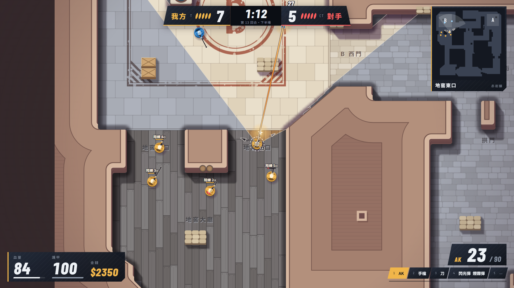

# CS 射擊 美術翻新 A 交付報告

2026-11-01 · 分支 `claude/cs-art-a-793cf2`（未 push） · 任務書：`docs/2026-11-01_CS射擊_美術翻新A_任務書.md`

一句話：試玩頁與觀戰頁已換成俯視戰術沙盤加天使金介面，引擎與雜湊沒動。驗收表全過；有三項要請你實玩或拍板，見最後兩節。

## 一、驗收表

| 項目 | 門檻 | 結果 | 數據 |
| --- | --- | --- | --- |
| 烘焙 | 三張離屏圖、24 px／格、120×120 ≤ 1 秒、換地圖重烘 | 過 | 首次 440～500 ms，之後 148～235 ms；沒有 GPU 時 250～283 ms。換地圖重烘並釋放舊圖 |
| 材質分區 | 查表、查不到石板、不改 `MapInfo`、涵蓋 `redrock` 與 `redrock2` | 過 | `materials.ts`；`redrock2-v3` 等四版的區域代號都在表內，全圖見 [maps-overview](shots/art-a/maps-overview.png) |
| 牆輪廓 | 斜切格是真 45° 邊、牆路徑不蓋可走格 | 過 | 瀏覽器用含倒圓角的真路徑跑 `isPointInPath`：赤岩鎮 7148 格、赤岩舊城 v3 6533 格，蓋到 0 格。測試另驗階梯、四方向斜切格、沙城與各版赤岩舊城 |
| 矮牆道具 | 固定雜湊選型、形狀即碰撞矩形、牆邊道具只在牆格 | 過 | `lowKind` 同輸入同輸出；矮牆併矩形後面積等於矮牆格數 |
| 迷霧 | 記憶圖、視線算法不變、牆層在迷霧上 | 過 | 蹲姿矮牆規則見 [crouch](shots/art-a/crouch.png)，遇煙即停見 [fx-smoke-fire](shots/art-a/fx-smoke-fire.png) |
| 模型兵 | 站、蹲、下包／拆包、屍體、8 種武器含刀、持炸彈背包紅、LOD | 過 | [weapons-x3](shots/art-a/weapons-x3.png)、[bomb-plant](shots/art-a/bomb-plant.png)；LOD 門檻 16 px／格（等於 1080p 的縮放 0.7） |
| 特效 | 彈道、槍口、煙、火、爆炸、閃光、手雷環、炸彈標記、受傷暗角、聲音箭頭 | 過 | [fx-smoke-fire](shots/art-a/fx-smoke-fire.png)、[fx-nades](shots/art-a/fx-nades.png)、[fx-blast](shots/art-a/fx-blast.png)、[fx-blast2](shots/art-a/fx-blast2.png)、[fx-flash](shots/art-a/fx-flash.png)、[bomb-planted](shots/art-a/bomb-planted.png)。全程固定雜湊 |
| 區域路標 | 噴在地上、迷霧裡讀得到；包點模板塗裝 | 過 | 烘進地面，所以記憶圖裡也有；赤岩鎮 21 個、赤岩舊城 v3 34 個 |
| HUD | 全部換天使金；兩種解析度無溢出無重疊 | 過 | 1920×1080 與 1366×768 逐張看過，見下方截圖表 |
| 效能 | 1920×1080、dpr 1、10 單位、三張迷霧貼圖 ≤ 4 ms | 過 | **平均 0.96 ms**（0.83～1.17），量法與其他環境見第三節 |
| 不變 | `src/shooter/*`、`bots/*`、`lineup.ts` 不改；協定只加選用欄位；雜湊不變 | 過 | 從併入 Bot 等級的 7c39527 到現在，這些路徑 diff 為空；`test/shooter-trial-lineup.test.ts` 與閘道測試通過 |
| 工程 | typecheck、eslint、vitest（除 S16）、build:web | 過 | vitest 461 過、1 略過、1 失敗（既有的 S16）；其餘全過 |

## 二、截圖

全部放在 `docs/shots/art-a/`，共 24 MB。用本機 Edge 無頭模式走 CDP 截的（dpr 1）。

| 項目 | 檔案 |
| --- | --- |
| 我方 T、我方 CT（敵我色） | [play-t-1920](shots/art-a/play-t-1920.png)、[play-ct-1920](shots/art-a/play-ct-1920.png) |
| 1366×768 | [play-t-1366](shots/art-a/play-t-1366.png)、[buy-1366](shots/art-a/buy-1366.png)、[board-1366](shots/art-a/board-1366.png)、[result-1366](shots/art-a/result-1366.png)、[setup-1366](shots/art-a/setup-1366.png) |
| 蹲姿 | [crouch](shots/art-a/crouch.png)、[crouch-x3](shots/art-a/crouch-x3.png) |
| 煙、火、閃光、爆炸 | [fx-smoke-fire](shots/art-a/fx-smoke-fire.png)、[fx-flash](shots/art-a/fx-flash.png)、[fx-nades](shots/art-a/fx-nades.png)、[fx-blast](shots/art-a/fx-blast.png)、[fx-blast2](shots/art-a/fx-blast2.png) |
| 下包 | [bomb-plant](shots/art-a/bomb-plant.png)、[bomb-planted](shots/art-a/bomb-planted.png) |
| 設定卡、購買、計分板 | [setup-1920](shots/art-a/setup-1920.png)、[buy-1920](shots/art-a/buy-1920.png)、[board-1920](shots/art-a/board-1920.png) |
| 結算 | [result-win-1920](shots/art-a/result-win-1920.png)、[result-lose-1920](shots/art-a/result-lose-1920.png) |
| 觀戰與全圖 | [spectate-follow](shots/art-a/spectate-follow.png)、[spectate-xray](shots/art-a/spectate-xray.png)、[spectate-map](shots/art-a/spectate-map.png)、[spectate-tactical](shots/art-a/spectate-tactical.png)、[spectate-tactical-follow](shots/art-a/spectate-tactical-follow.png) |
| 經營層觀戰 | [watch-loading](shots/art-a/watch-loading.png)、[watch-play](shots/art-a/watch-play.png)、[watch-end](shots/art-a/watch-end.png) |
| 全圖材質（赤岩鎮、赤岩舊城 v3） | [maps-overview](shots/art-a/maps-overview.png) |

對局、特效、炸彈、計分板、結算的截圖是用除錯掛勾擺的場景（改主執行緒要畫的資料，不經過 Worker）。[watch-end](shots/art-a/watch-end.png) 是真的跑完一場 35 回合，但票是手寫的假成績，所以那行「與成績單不符」是預期結果，不是 bug。

## 三、效能

**量法**：`__sg.bench(60)` 同步連畫 60 幀，最後讀一個像素逼畫布把指令畫完，總時間除以 60，跑 5 輪。場景是 10 名單位，含開火、一顆煙、一片火，迷霧開著。分頁在背景時 rAF 不跑，所以不用 rAF 計時。

| 環境 | 解析度 | 每幀 |
| --- | --- | --- |
| Edge 無頭、RTX 5080、dpr 1 | 1920×1080 | 0.83～1.17 ms，平均 0.96 ms |
| 同上 | 1366×768 | 0.71～0.83 ms |
| 內建瀏覽器、dpr 1.75（畫布 3360×1890） | 1920×1080 | 1.8～2.4 ms（量的場景是 7 名單位） |
| 關掉 GPU（Microsoft Basic Render Driver） | 1920×1080 | **26 ms** |
| 同上 | 1366×768 | 14 ms |

門檻只在有 GPU 時成立。這台是 RTX 5080，內顯沒量過；完全沒有 GPU 加速時 1080p 約 38 fps。

**記憶體估算**：地面、記憶圖、牆與道具各 2880²×4 ＝ 33 MB，共 100 MB；迷霧畫布約 10 MB（1080p、dpr 1）；小地圖 1 MB；煙貼圖最多 8 張共 2 MB。合計約 113 MB，dpr 2 時迷霧畫布變成 40 MB。

## 四、與任務書的出入

1. **多一個檔案 `outline.ts`**：輪廓幾何沒放 `bake.ts`。測試走 Node 的 tsconfig，那邊沒有 `Path2D`，所以把沒有 DOM 的部分拆開。
2. **commit 沒有切到任務書那麼細**：渲染器、HUD、CSS 互相依賴（`TEAM_COLOR` 拿掉後要一起改），放在同一個 commit 0319772。P0 與大部分 P1 的程式也是第一輪一起寫的，所以 P0 沒有單獨截一輪圖。
3. **煙畫在單位之下**：樣張是煙蓋住人。正式版如果蓋住，觀察資料裡有的人就看不到了，等於改了看得到什麼，所以人畫在煙上面。
4. **「全圖」拆成三個開關**：`X` 全圖透視照舊，鏡頭還是跟人；新增 `M` 全圖鏡頭（整張地圖塞進畫面）、`T` 戰術疊層。開 `M` 或 `T` 會自動帶上透視。控制列也有按鈕。
5. **協定多兩個選用欄位**：`FullPlayer.crouching`、`working`，觀戰才看得到蹲與下包；`worker.ts` 只動全狀態快照那一行。
6. **我方永遠在左**：頂列、計分板、結算都改成我方左、對手右，原本是 T 左 CT 右，換邊時會跳。介面顏色也從 T／CT 改成我方金、對手紅。
7. **試玩觀戰的隊色**：沒有「我方」，先攻組當金、先守組當藍，介面叫先攻組／先守組。別隊的比賽（經營層觀戰）世界裡主隊白、客隊藍，金只給我方。
8. **擺設表**：`MapInfo` 沒有井與帆布的資料，放在 `materials.ts` 依地圖代號查；壓到牆或箱子的帆布不鋪。`redrock2-v3` 的帆布與井座標都對不上新格局，所以目前沒有。包點圓環改成自動找離障礙最遠的位置。
9. **敵人屍體與爆炸都是推的**：屍體只在「前一刻看得見、擊殺訊息公開」時才留在最後位置；爆炸要看到彈體消失且聽到爆炸才畫，所以視野外的手雷不會有畫面。
10. **修了一個既有 bug**：Bot 等級分支帶進來的 `setLoading` 在觀戰頁找不到元素，**經營層觀戰會永遠卡在「準備觀戰」**。已在這條分支修掉（5a6d78c）；`claude/cs-bot-levels-2de38f` 本身還有這個問題。
11. **小改字**：購買選單「彈藥（補滿備彈）」改「補滿彈藥」，原字會被價格切掉；設定卡的觀戰與全螢幕說明縮短，按鍵表加一行觀戰鍵；`lineup-note` 從 `span` 改 `p`，`id` 不變。
12. **觀戰預設縮放**：從 0.85 改 1.0，配合模型放大。
13. **CSS 變數選複製**：`angel.css` 的變數掛在 `#stage` 底下，引入也取不到，所以複製到 `web/shooter.css`。
14. **除錯掛勾變多**：`__sg` 加了 `perf`、`bench`、`stage`、`patch`、`hud`、`baked`，和原本一樣只在開發模式或 `?debug` 才有。

## 五、沒做到的

- **沒有人實際用滑鼠打過一場**。自動驗收涵蓋畫面與流程，手感、30 格視野邊緣是否夠用、蹲姿辨識度都要你玩過才算數。算出來的是：預設 1.2 時滑鼠推到畫面上下邊緣剛好看到 30 格。
- **玩家模式的結算沒有真的打完一場**，是用掛勾叫出來的；真實跑完的是經營層觀戰那條路。兩邊畫面同一套，但按鈕「再來一場」沒有在新版實測。
- **成績單一致的那一行沒實測**：上面說的假票只驗到不一致的畫面，一致的路徑靠閘道測試。
- **蹲姿差異偏小**：只縮 12% 加膝蓋，LOD 下看不出來。
- **內顯效能**沒量。
- **進場會卡一下**：第一次烘焙在主執行緒，約 0.2～0.5 秒；設定卡是先出畫面再烘。
- **P2**：走路擺動、後座力、拋殼做了；縮放拉遠只有任務書要求的基本 LOD，沒有再細修。

## 六、給使用者決定的事

- 預設縮放 1.2 實玩感受；不夠看可以退回 1.0，改 `main.ts` 的 `ZOOM_PLAY`。
- 戰術疊層預設關，要不要開經營層觀戰時預設開。
- 試玩觀戰用金色當先攻組可以嗎，還是要比照別隊比賽用白與藍。
- 煙畫在單位之下，你若覺得人浮在煙上很怪，代價是看不到煙裡的人。
- 沒有 GPU 時要不要做降級（不畫記憶圖、改半透明壓暗），目前沒做。
- 新地圖 `redrock2-v3` 要不要補帆布與井的座標，這要等地圖定稿。
- 截圖 24 MB 進 repo 可以嗎；要瘦身可以換成 JPEG。

## 七、給新地圖工作階段

`main.ts` 與 `web/shooter.html` 這邊改動很大，合併時會有衝突。設定卡欄位的 `id` 都保留，地圖下拉加在 `.sg-lineup` 同一區即可。設定卡背景固定畫預設地圖的 A 包點，換地圖不影響；開局烘焙照 `meta.map` 自動重烘，`hud` 的地圖名也讀 `meta.map.name`。
