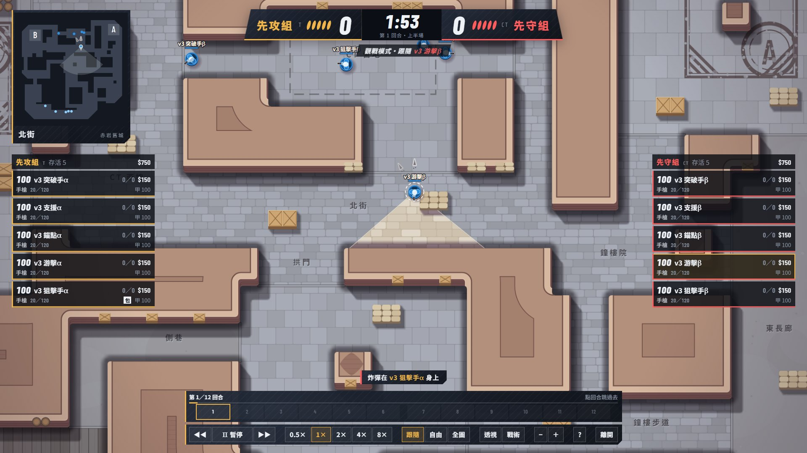

# CS 射擊 介面 UX 2.0 交付報告

2026-11-02 · 分支 `claude/cs-ux-2-0-9246b1`（未 push） · 任務書：`docs/2026-11-02_CS射擊_介面UX2.0_任務書.md`

> 第二輪（2026-11-02，PR #5 合併後）的改動與量測在第九節；第八節已更新成使用者的決定。

一句話：觀戰現在用滑鼠就能完整操作，全圖不再跳動；商店改成有分類、數值和比較的版面。驗收表逐項通過，只有 vitest 那列有條件：機器滿載時會多出時限測試失敗，基準 commit 也一樣，見第三節。手感還沒有真人試過。

## 一、全圖跳動的原因

不是 Bot，也不是跟隨對象，是 `render.ts` 的過渡寫錯。`overviewBlend` 到 1 之後，`ovTarget > blend` 不成立，走進遞減分支，每幀在 1 和 1−step 之間來回。

| 版本 | 連續 300 幀鏡頭中心最大變化 | 縮放最大變化 |
| --- | --- | --- |
| 舊版（6cdc7e4） | **303.5 單位**（0.3 格，約 2.6 px） | 0.0000506 |
| 新版 | **0** | **0** |

新版全圖由 `camera.ts` 算一次固定值，到位後直接等於那個值，不再逐幀運算。全圖與自由鏡頭也關掉了致盲白幕、受傷暗角、聲音箭頭，這些是跟隨對象的第一人稱效果，以前會在全圖裡閃整個畫面。

## 二、驗收表

| 區塊 | 項目 | 結果 | 數據 |
| --- | --- | --- | --- |
| 觀戰 | 滑鼠操作 | 過 | 控制列 13 種按鈕都用真實滑鼠事件點過（速度 5 顆算一種，只點過 2 顆）；點世界、小地圖、列表都切到指定的人；拖曳進自由鏡頭；滾輪後游標下世界點漂移 0；雙擊空地回跟隨 |
| 觀戰 | 游標永遠可見 | 過 | 跟隨 `grab`、指著人 `pointer`、拖曳 `grabbing`；沒有出現 `none` |
| 觀戰 | 鏡頭阻尼 | 過 | 時間常數 130 ms（`FOLLOW_TAU_MS`），除以 √速度倍率。切換跟隨對象移動 6.3 萬單位，單幀最大 3159 單位（5%），沒有瞬移 |
| 觀戰 | 全圖零跳動 | 過 | 300 幀中心與縮放最大變化都是 0，見第一節 |
| 觀戰 | 自由鏡頭邊界 | 過 | 中心夾在地圖外 6 格內；單元測試與瀏覽器都驗過 |
| 觀戰 | 面板 | 過 | 兩隊列表、擊殺訊息、回合時間軸、炸彈倒數都有；下包中有標籤與進度條 |
| 觀戰 | 上一回合、時間軸跳回合 | 過 | 跳回第 3 回合後 tick、比分、10 人位置、錢、武器、血、甲和第一次**完全相同** |
| 觀戰 | 進度顯示 | 過 | 第幾回合、回合進度條、目前回合高亮 |
| 觀戰 | 鍵盤 | 過 | 既有熱鍵保留，新增 `P` 上一回合；`?`、`H` 叫出按鍵表 |
| 觀戰 | 兩個入口 | 過 | 用閘道真跑一場做成的票：17 回合打完顯示「✓ 與經營層成績單一致」。別隊比賽的中性外框也驗過 |
| 商店 | 版面 | 過 | 四分類、商品卡、武器剪影、熱鍵、四種狀態、倒數、現在與購買後金錢 |
| 商店 | 武器數值 | 過 | 全部從 `meta.weapons` 換算；同類別長條；和身上同槽位的槍比，金 ▲ 較好、紅 ▼ 較差 |
| 商店 | 道具與裝備 | 過 | 道具有價格、最多攜帶、半徑、持續、引信、傷害、陣營；裝備有價格與一句效果 |
| 商店 | 操作 | 過 | 點卡片買到（護甲扣 $650）、熱鍵買到（閃光 $200）；買不起顯示「AK：還差 $1900」、敵方武器顯示「M4：限 CT 購買」。引擎沒有賣出與退貨，所以沒做 |
| 通用 | 解析度 | 過 | 1920×1080 與 1366×768：觀戰 9 個面板互不重疊、不超出；商店卡片與數值沒有被截斷，不壓到小地圖、血甲、武器面板 |
| 通用 | 效能 | 過 | 見第四節；商店開啟 2.0 ms、關閉 0.2 ms |
| 通用 | 不變 | 過 | `src/shooter/`、`bots/`、`src/manage/`、`scripts/`、`lineup.ts` diff 為空；`test/shooter-trial-lineup.test.ts` 通過 |
| 工程 | typecheck、eslint、build:web | 過 | 三項都無錯誤 |
| 工程 | vitest | **有條件** | 見第三節 |

## 三、vitest 的實際結果

新增 `test/shooter-ux.test.ts` 21 個測試全過：數值換算（和引擎 `armorSplit`、`damageAt` 對照）、鏡頭平滑與邊界、跳回合雜湊（陪練與基準 Bot 都驗）。

但完整跑時不是只失敗 S16。量測當下 Bot 2.2 的 `shooter-gradient` 正在跑，CPU 85～100%。

| 跑法 | 結果 |
| --- | --- |
| 本分支完整 | 492 過、4 失敗：S16、`legion` 確定性、`sandbox` decide 逾時、`shooter-players` 確定性 |
| 基準 6cdc7e4 完整（同樣滿載） | 470 過、5 失敗：同上四項，再加 `conquest` |
| 本分支只跑那三個檔案 | 42 過、0 失敗 |

判斷是滿載時的決策時限測試不穩定，不是這次改動造成：基準 commit 一樣失敗，這些測試也沒有引用 `src/web/shooter`。**我沒有量到機器空閒時的完整結果**，所以「除 S16 全過」目前是推論，不是實測。

## 四、效能

無頭 Edge、RTX 5080、dpr 1，10 名單位。量測時 CPU 接近滿載。

| 場景 | 解析度 | 畫面 | 含面板的整幀 | 主執行緒全部（含 style、layout） |
| --- | --- | --- | --- | --- |
| 跟隨 | 1920×1080 | 0.58 ms | 0.77 ms | **1.33 ms** |
| 全圖＋戰術疊層 | 1920×1080 | 0.59 ms | 0.78 ms | **1.33 ms** |
| 全圖 | 1366×768 | 0.32 ms | 0.48 ms | 沒量 |

主執行緒數字來自 CDP `TaskDuration` 除以 5 秒內的幀數，不含 GPU 點陣化。內顯與無 GPU 沒量。

跳回合要重跑：往前跳時，上一回合（第 6 回第 5）2.8 秒，最壞量到第 17 回跳第 16 回 9.0 秒，約每回合 0.5 秒。等待時畫面顯示進度，往後跳不必重跑。

## 五、截圖

全部在 `docs/shots/ux-2/`，共 29 張 6.5 MB。這次改用 JPEG，比上一包的 24 MB 小。都是真實比賽畫面，沒有用除錯掛勾擺場景。

| 項目 | 檔案 |
| --- | --- |
| 三種鏡頭 | [跟隨](shots/ux-2/cam-follow.jpg)、[自由](shots/ux-2/cam-free.jpg)、[全圖](shots/ux-2/cam-overview.jpg) |
| 點列表跟隨、指著人 | [list-follow](shots/ux-2/list-follow.jpg)、[hover-overview](shots/ux-2/hover-overview.jpg) |
| 跳回合 | [上一回合](shots/ux-2/prev-round.jpg)、[時間軸跳第 3 回合](shots/ux-2/seek-round3.jpg)、[時間軸](shots/ux-2/timeline.jpg)、[重跑提示](shots/ux-2/seek-progress.jpg) |
| 擊殺與炸彈 | [擊殺訊息](shots/ux-2/killfeed.jpg)、[下包中](shots/ux-2/planting.jpg)、[已下包](shots/ux-2/bomb-planted.jpg) |
| 其他觀戰 | [戰術疊層](shots/ux-2/tactical-follow.jpg)、[按鍵表](shots/ux-2/help.jpg) |
| 商店四分類 | [手槍](shots/ux-2/shop-pistol.jpg)、[主武器](shots/ux-2/shop-primary.jpg)、[裝備](shots/ux-2/shop-gear.jpg)、[道具](shots/ux-2/shop-nade.jpg) |
| 商店狀態 | [比較高亮](shots/ux-2/shop-compare.jpg)、[買不起](shots/ux-2/shop-poor.jpg)、[已持有](shots/ux-2/shop-owned.jpg) |
| 1366×768 | [觀戰](shots/ux-2/spectate-1366.jpg)、[全圖](shots/ux-2/overview-1366.jpg)、[商店](shots/ux-2/shop-1366.jpg)、[商店道具](shots/ux-2/shop-1366-nade.jpg) |
| 經營層觀戰 | [我方的比賽](shots/ux-2/watch-follow.jpg)、[別隊的比賽](shots/ux-2/watch-neutral.jpg)、[結算](shots/ux-2/watch-end.jpg)、[結算後回看](shots/ux-2/watch-seek.jpg) |

## 六、與任務書的出入

1. **`worker.ts` 不只動訊息處理**：`fullState` 多帶列表要的欄位，`launch` 的 meta 多帶開鏡速度。建驅動的呼叫包成函式才能重建，內容沒改。模擬沒動。
2. **`WeaponInfo` 沒有開鏡移速**，而 `src/shooter/` 不能改。Worker 從 `WEAPONS` 補一個選用欄位 `meta.scopedSpeeds`，其餘數值照任務書只讀 `meta.weapons`。
3. **協定多一種訊息 `seeking`**：回報重跑到第幾回合，最壞要等 9 秒，不能沒有回饋。
4. **擊殺訊息用既有的 `frame.feed`**：它本來就來自引擎的 `m.kills`，不用推，協定也不用加。武器從代號改成全名（「手槍」不是「P」），試玩的陣亡提示同時受惠。
5. **陣營限定不過濾掉**：任務書同時寫「依陣營過濾」和「陣營限定狀態」。我讓敵方武器留著，加斜線灰底排到最後，沒有熱鍵。
6. **多一張配發手槍的卡**：買不到，放著才看得到身上那把的數值，手槍分類也不會只剩一張。
7. **商店靠左**：放滿左邊但讓開小地圖，不是置中；這樣小地圖、血甲、武器面板都不被蓋住。
8. **精度條的基準**：站定與移動共用「同類別最小站定散佈 ÷ 這個散佈」，兩條長度能直接比。任務書只寫同類別正規化。
9. **觀戰收起血甲與武器面板**：資料都在列表裡。
10. **控制列不放鍵帽**：熱鍵移到提示與按鍵表，免得滿排按鍵提示。
11. **透視的規則變了**：全圖與自由鏡頭一律看全狀態；在這兩種模式關透視會回到跟隨。
12. **跟隨也有邊界**：貼著地圖邊時鏡頭停住，不露出一大片空白，人會稍微偏離中心。滾輪在跟隨時先固定游標下的點，約 0.65 秒回正到人身上。
13. **額外加的**：結算的「回看比賽」按鈕、小地圖點空地移動自由鏡頭、小地圖上的視野框、指著人的細環與名字、戰術標註改成平滑換層（原本會整條跳）。
14. **commit 順序和任務書不同**：滑鼠、面板、跳回合的畫面端都在 `spectate.ts` 與 `main.ts`，拆不開，所以是「鏡頭 → Worker 跳回合 → 觀戰介面 → 商店資料 → 商店版面 → 測試 → 報告」。每層都能編譯。
15. **時間軸的未來回合也能點**：等於快轉到那裡。加時的格子要打到才出現，因為事先不知道會不會加時。

## 七、沒做到的

- **沒有人實際用滑鼠操作過**。自動驗收用的是真實滑鼠事件，但阻尼、拖曳、滾輪的手感要你試過才算數。
- **vitest 沒有在機器空閒時完整跑過**，見第三節。
- **內顯與無 GPU 的效能**沒量。
- **自由鏡頭沒有鍵盤平移**，任務書沒要求。
- 其他長寬比與手機沒看。
- **專案首頁開不了這條工作樹**：`C:\Claude\Tools\Project-Hub\projects.json` 的 `angel-ux-2-0` 與 `angel-bot-2-2`，`cwd` 都是沒展開的 `$(echo …)` 字串。那個檔案不在這次範圍，我沒改。

## 八、給使用者決定的事

使用者已決定：

| 問題 | 決定 | 狀態 |
| --- | --- | --- |
| 跟隨阻尼 130 ms | 先不動 | 維持 |
| 觀戰預設透視 | 經營層觀戰預設開，試玩觀戰維持關 | 已做，見第九節 |
| 全圖補畫開火與彈道 | 要，只在全圖與自由鏡頭畫，跟隨照舊 | 已做，見第九節 |
| 敵方專屬武器留在商店 | 留 | 維持 |
| 跳回合最壞約 9 秒 | 接受，不做快照 | 維持 |

## 九、第二輪：經營層預設透視、全圖與自由鏡頭的彈道

分支先併入 main（6862d35，含 PR #5 與 Bot 2.2），再做這兩項，commit 841252b。

### 改了什麼

- **經營層觀戰預設開透視**：`meta.watch` 有值時 `xray` 初值為開，試玩觀戰維持關；可以手動關。
- **所有人的彈道**：`FullState` 加選用欄位 `shots`，每個 frame 只帶新開的子彈。全圖與自由鏡頭畫這份，跟隨仍畫觀察資料那份。
- **開火**：全圖與自由鏡頭遠看也畫槍口火光（原本遠看降級不畫）。
- **全圖的彈道加粗**：遠看時最細 2.2 px，原本 1.5 px 不夠明顯。
- **傷害數字**：全圖與自由鏡頭不再畫跟隨對象的傷害數字。這是驗收時截圖看到的問題，算第一人稱效果。
- **跳回合**：跳回合與下一回合會重設已送出的子彈 tick，不會補畫舊子彈。

### 與指示的出入

引擎的子彈紀錄 `shotLog` 是 private，而 `src/shooter/` 不能改。新檔 `shots.ts` 用 `Reflect.get` 唯讀取用，測試驗欄位，並比對有無取用時的雜湊相同。引擎日後改名時測試會失敗，不會默默沒有彈道。若要乾淨一點，下次動引擎時可以開公開的唯讀方法。

### 驗收

| 項目 | 結果 | 數據 |
| --- | --- | --- |
| 預設透視 | 過 | 試玩關；經營層開，手動關後維持跟隨 |
| 跟隨畫面不變 | 過 | 暫停、固定鏡頭，放入 40 條彈道：跟隨畫面雜湊相同；全圖、自由鏡頭會變。同條件連畫兩次無雜訊 |
| 真實交火 | 過 | [全圖](shots/ux-2-r2/overview-shots.jpg)、[自由鏡頭](shots/ux-2-r2/free-shots.jpg)，經營層預設畫面見[這張](shots/ux-2-r2/watch-xray-default.jpg) |
| 彈道不重複不漏、狀態不變 | 過 | 陪練打兩回合；每步取用與不取用的終局雜湊相同 |
| 效能 | 過 | 全圖放 40 條彈道連畫 60 幀 5 輪：0.47～0.60 ms。跟隨含面板 0.55 ms、主執行緒全部 0.99 ms；全圖加戰術 0.62 ms、1.18 ms |
| 第一輪重測（併入 Bot 2.2 後） | 過 | 全圖 300 幀變化 0；跳回第 3 回合狀態相同；解析度無重疊；重跑真實票顯示「與經營層成績單一致」（8 回合） |
| 不變 | 過 | 相對 main，`src/shooter/`、`bots/`、`src/manage/`、`scripts/`、`lineup.ts` diff 為空；`test/shooter-trial-lineup.test.ts` 通過 |
| typecheck、eslint、build:web | 過 | 無錯誤 |

### vitest

量測時 Bot 量測 `shooter-strength` 把 CPU 吃到 99%，機器仍然不是空閒狀態。

| 跑法 | 結果 |
| --- | --- |
| 完整 | 513 過、7 失敗：S16、`commentary` 兩項、`conquest`、`legion`、`sandbox`、`shooter-players` |
| `legion`、`sandbox`、`shooter-players`、`conquest`、`commentary`、`shooter-ux`、`shooter-trial-lineup` 單跑 | 全過 |

和第三節同一類：滿載下的時限失敗，單跑就過。**機器空閒時的完整結果還是沒量到**，這一項維持未驗證。S16 是既有失敗，這次單跑沒有包含它。
