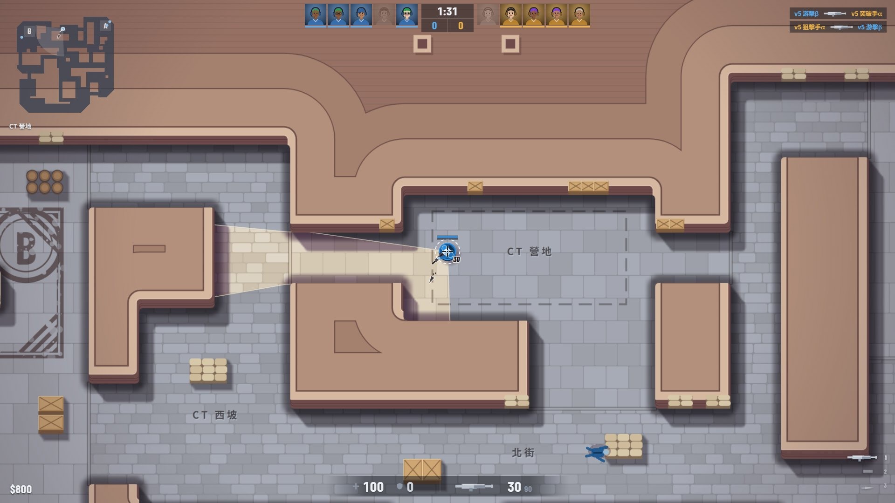

# CS 射擊 介面 UX 2.1 交付報告

2026-11-02 · 分支 `claude/cs-ux-2-1-528f14`（未 push）

一句話：對局 HUD 改成 CS 式的半透明版面，隊色改成 T 黃、CT 藍，商店閃爍修好。驗收表過，vitest 只剩既有的 S16。真人還沒試玩過這版，下包提示與低血量畫面也沒有實測，見第五節。

## 一、問題清單與改動

| # | 使用者的問題 | 原因 | 改動 | 改前 | 改後 |
| --- | --- | --- | --- | --- | --- |
| 1 | 商店有時打開會閃爍 | 不能買時按 B 也會開，下一個 frame `canBuy` 為假又自動關，只停留約 8 ms | 不能買時不開，錢旁邊提示「不在購買時間或出生區」 | 開、8 ms 後關 | 不開，提示 1.6 秒 |
| 2 | 純色擋視野 | 面板不透明，還有金邊和切角 | 對局 HUD 改 48% 半透明底與細線，不用切角 | [改前](shots/ux-2-1/before-play.jpg) | [改後](shots/ux-2-1/play-live.jpg) |
| 3 | 重要資訊要靠中間 | 血、甲、彈藥分在兩個角落 | 血、甲、武器、彈藥集中到下方中央；小地圖左上、擊殺右上、金錢左下、武器欄右下 | 同上 | 同上 |
| 4 | 字太大 | 血 62 px、彈藥 72 px、比分 60 px | 血與彈藥 30 px、比分 22 px、時間 25 px | 同上 | 同上 |
| 5 | 頭上放血條 | 自己沒有 | 自己 44 px 加甲條，隊友 34 px，遠看 20 px | 同上 | 同上 |
| 6 | 記分板用頭像，不標敵我，不要說明文字 | 5 個點加「我方／對手／CT」 | 兩邊各 5 個頭像，陣亡變灰；隊友頭像下有血條；只留時間與比分 | 同上 | 同上 |
| 7 | 時間與比分加細線分隔 | 小樣裡擠在一起 | 時間下一條橫線，兩個比分中間一條直線 | 小樣 | [改後](shots/ux-2-1/play-live.jpg) |
| 8 | 商店配合調整 | 底板不透明，右邊要讓開舊小地圖 | 置中，78% 半透明，拿掉金邊與斜體，字縮小 | [改前](shots/ux-2/shop-primary.jpg) | [改後](shots/ux-2-1/play-shop.jpg) |
| 9 | 商店不用算給玩家看 | 底部「目前金錢 → 購買後」、卡片「差 $」 | 全部拿掉，錢不夠只有紅色價格；點了才顯示「金錢不足」 | 同上 | 同上 |
| 10 | 配色改藍黃 | 隊色原本依敵我：世界我方金、對手藍，介面對手紅 | T 黃、CT 藍，介面、世界、小地圖、時間軸一致，換邊時跟著換 | [改前](shots/ux-2-1/before-play.jpg) | [換邊後](shots/ux-2-1/spectate-swap.jpg) |

## 二、驗收表

| 項目 | 結果 | 數據 |
| --- | --- | --- |
| 商店閃爍 | 過 | 改前量到開與關相差 8 ms；改後真按 B，商店沒有開，提示有出現 |
| 換邊 | 過 | 觀戰跳到第 7 回合：左隊頭像、列表、比分都從 `#f0b54a` 變 `#57aef5`，球衣同步更換 |
| 1920×1080 | 過 | 對局、商店、計分板、觀戰、全圖都看過，無重疊 |
| 1366×768 | 過 | 同上加結算，字沒有被截斷 |
| 經營層觀戰 | 過 | 自製一張別隊比賽的票：隊名、角色標籤、頭像 10＋10 都正常。票的成績單是假的，所以沒驗「與成績單一致」 |
| 視野公平 | 過 | 敵人血量對局中拿不到（`visibleHp` 有測試），頂部只畫隊色線；陣亡狀態本來就公開 |
| 不變 | 過 | 相對 b044b01，`src/shooter/`、`bots/`、`src/manage/`、`scripts/`、`lineup.ts`、`worker.ts` diff 為空 |
| typecheck、eslint、build:web | 過 | 無錯誤 |
| vitest | 過 | 526 過、1 略過、1 失敗（既有 S16）。上一輪完整跑是 2 失敗，另一項沒留到名字；最後這輪只剩 S16 |

## 三、效能

無頭 Edge、dpr 1、1920×1080、10 名單位。`__sg.bench(60)` 跑 5 輪；含面板的整幀是實際跑 6 秒的平均。

| 場景 | 畫面（bench） | 含面板的整幀 |
| --- | --- | --- |
| 對局 | 0.26～0.40 ms | **1.12 ms** |
| 觀戰跟隨 | 0.66～1.09 ms | **1.42 ms** |
| 全圖 | 0.25～0.31 ms | **1.49 ms** |

都在 4 ms 內。整幀比 UX 2.0 報告的 0.77 ms 高，但量測環境不同，不能直接比。頭像是靜態 DOM，只有換邊時重建，每幀只改 class 與血條寬度。內顯與無 GPU 沒量。

## 四、與使用者討論時的決定

- **看過小樣才動手**：HUD 版面、時間比分的細線，使用者都確認過。
- **隊色**：使用者指定藍黃。我照「T 黃、CT 藍」解讀，跟陣營走，不跟敵我走。
- **敵人血條**：對局中不畫，這是視野公平底線；觀戰全員都有。
- **教學文字**：「靠著箱子要蹲」「帶炸彈到 A／B 點」這類句子全拿掉，只留「按住 E 下包／拆包」。
- **金錢改白字**：黃色現在是 T 的隊色，金只留給選中與主要行動，自己是 CT 時才不會誤讀。
- **別隊的比賽也用黃藍**：原本主隊白、客隊藍。選中外框與主要按鈕仍維持白色。
- **勝利與落敗標題**維持金與紅，那是結果，不是隊色。

## 五、沒做到的

- **真人還沒試玩**：手感、半透明夠不夠看，要使用者玩過才算數。
- **改動 9、10 之後的商店沒有再給使用者看小樣**，只有實作截圖 [play-shop](shots/ux-2-1/play-shop.jpg)。
- **沒實測到的畫面**：「按住 E 下包／拆包」提示、低血量變紅、陣亡後看隊友的提示。程式有寫，自動跑的局沒走到；陣亡與回合橫幅沒有截圖。
- **結算畫面**的比分是用掛勾擺的假資料，只用來看版面；左右順序不代表真實結果。
- **頭像與經營層可能不同臉**：觀戰票只帶名字，經營層用選手 id 加名字當種子。之後接選手頭像時要把 id 帶進來。
- **commit c514e64 單獨編不過 Node 那份 tsconfig**：測試引到 DOM 檔案，下一個 commit 拆出 `hudinfo.ts` 修好，分支終點正常。
- **已知待辦都沒動**：跟隨阻尼、自由鏡頭鍵盤平移、全圖遠看細節、跳回合快照、商店賣出、1366×768 以下與手機、設定卡。

## 六、檔案

- 新增 `src/web/shooter/scorebar.ts`（頂部計分、頭像、武器圖）、`hudinfo.ts`（純函式）、`test/shooter-hud.test.ts`。
- 改 `hud.ts`、`render.ts`、`soldier.ts`、`bake.ts`（小地圖去背）、`buy.ts`、`shop.ts`、`spectate.ts`、`main.ts`、`web/shooter.css`、`web/shooter.html`（多載入 Barlow 700）。
- 截圖在 `docs/shots/ux-2-1/`，17 張 3 MB。[`before-play`](shots/ux-2-1/before-play.jpg) 是改動前的同一個畫面。
